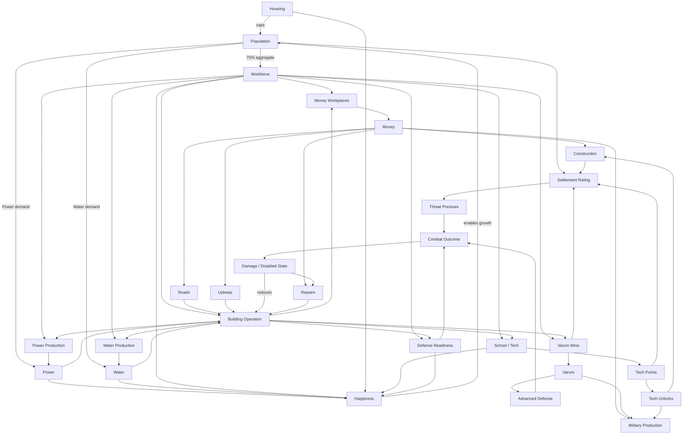

# 80 — Gameplay Systems Studio Re-Audit

Status: **P0 ECONOMY/GAMEPLAY DESIGN REOPENED — NO NEW GAMEPLAY FEATURE CODE UNTIL DEVSIM GATE**

Date: 2026-09-21

Scope:
- gameplay loop
- economy
- Population / Workforce
- utilities
- Tech / Varum
- construction / roads / blockers
- combat / damage / repair
- offline progression
- progression pressure
- system observability

This audit does **not** change runtime code or visual code.

---

## 1. Executive studio verdict

EverVale still has a coherent product fantasy:

`Plan → Build → Auto-staff → Observe → Improve → Defend → Recover → Expand`

But the current gameplay/economy lock is not sufficiently proven.

The previous readiness decision in:
- `docs/58_STUDIO_READINESS_AUDIT_2026-09-21.md`
- `docs/66_PRE_ENGINEERING_DESIGN_LOCK.md`

was too strong for Economy/Society because the long-run proof harness does not simulate the actual authoritative purchase/build/progression path.

### Main conclusion

**The code can deduct Money correctly and the economy can still be strategically empty.**

The current problem is not “there is no cost field”.

The problem is:

> Costs, production, utilities, Workforce, Tech, threat and recovery are not yet proven to form a network of meaningful player decisions.

Therefore the Economy/Game Loop design lock is reopened.

---

# 2. Current system network

The intended authoritative dependency network is:



A system is meaningful only if its incoming and outgoing edges matter in actual play.

At present several edges exist only in documentation or are too weak to create decisions.

---

# 3. P0 findings

## P0-01 — Economy has accounting, but the decision loop is weak

Current authoritative code does deduct costs for:
- buildings
- Props
- roads
- blocker clearing
- repairs

That does **not** prove a meaningful economy.

Money currently behaves mostly as:
- a build permission check
- a slowly refilling treasury
- a small repair sink

There is not yet enough consequence from:
- insufficient upkeep
- overexpansion
- poor utility planning
- bad Workforce allocation
- repeated combat losses

The player can often recover simply by waiting.

That creates the feeling:

**“Building is effectively free over time.”**

This is a gameplay problem, not a transaction bug.

---

## P0-02 — The intended core tension is Workforce, but the player does not yet control it

`docs/04_ECONOMY_RESOURCES.md` explicitly says:

> The intended problem is: Where should the next worker go?

This is a strong economy premise.

But it only works if:
1. Workforce is genuinely scarce.
2. competing uses are meaningful.
3. the player can influence priority.
4. the UI explains the consequence.

Current numeric priorities can make the choice automatically for the player.

Example with the current T0 baseline:

- Power Plant: priority 100
- Water Plant: 95
- Workshop: 80
- School: 70
- Guard Post: 45

Starter Population 12 gives:

`floor(12 × 0.75) = 9 Workforce`

Starter utility + Workshop demand is already 8 workers.

Only 1 worker is left.

This means a School or Guard Post can be partially/un-staffed, but the player currently lacks the documented strategic priority control needed to decide which function should lose output.

The strongest intended economic mechanic is therefore currently more automatic than strategic.

---

## P0-03 — Early Power/Water pressure is too weak to prove utility gameplay

Using current starter values:

### Power

Starter production:
- Power Plant = 40 / reference cycle

Starter approximate use:
- 12 residents = 6
- Water Plant = 4
- Workshop = 4

Total ≈ 14.

Production / demand ≈:

`40 / 14 = 2.86×`

### Water

Starter production:
- Water Plant = 35

Approximate use:
- 12 residents = 9
- Workshop = 1

Total ≈ 10.

Production / demand:

`35 / 10 = 3.5×`

Ignoring added-building demand, starter utilities can roughly support:
- Power: ~64 residents
- Water: ~45 residents

before production alone reaches resident + starter-building demand.

This means a town can expand several times beyond its initial size before a second utility plant becomes strategically necessary.

That contradicts the intended early loop where utility capacity should compete with:
- Housing
- income
- School
- defense

Utility management is currently visually present before it is economically important.

---

## P0-04 — Existing long-run simulator does not prove its own contract

Canonical contract:

`docs/60_LONG_RUN_SIMULATION_CONTRACT.md`

Reference harness:

`tools/simulation/simulate_long_run.py`

The harness is useful as a smoke model but is **not valid proof of the complete gameplay economy**.

### Critical gaps

#### Buildings are added for free

`add_building()`:
- increments building count
- increases caps
- increases Housing

It does not:
- deduct Money
- deduct Varum
- consume a construction slot
- wait construction time
- validate Tech
- validate road access
- validate placement
- model player choice

Therefore S1/S2/S3 are not actual player progression paths.

#### Scenario setup bypasses progression

Examples:
- Healthy town receives House + School + Park + Guard Post without paying.
- Varum scenario directly sets T1 / Tech 40 and adds the Mine.
- Overexpanded town receives many buildings without construction or treasury pressure.

#### Funding failure is not simulated

The docs define:
1. discretionary services lose funding
2. advanced facilities throttle
3. defense readiness falls
4. core utilities are protected

The harness does not execute this model.

#### Combat and repair are not integrated

The harness uses a lightweight random Money loss proxy.

It does not model:
- real wave generation
- structure damage
- disabled production
- defense readiness
- repair queue
- repair duration
- recovery burden

#### Balance constants are duplicated in code

The Python harness hardcodes numbers already present in balance data, including examples such as:
- 0.50 Power / citizen
- 0.75 Water / citizen
- happiness weights
- growth coefficient
- growth cap

This creates model drift.

### Studio conclusion

The existing long-run harness must be demoted to:

**EXPLORATORY SMOKE TOOL**

until DevSim v2 uses the same authoritative rules as the server.

---

## P0-05 — “Overexpanded” does not currently produce the documented failure mode

`docs/60_LONG_RUN_SIMULATION_CONTRACT.md` expects S2 Overexpanded:

- reserves drain
- Happiness falls
- Growth stops
- low-priority buildings idle
- town remains recoverable

A cost-aware deterministic audit using current T0 data instead shows a different pattern:

- low-priority buildings can indeed starve for workers
- Money can become low
- but Power/Water remain highly comfortable
- Happiness remains high
- Growth can continue
- the player may not understand that Workforce, not utilities, is the true bottleneck

Therefore the scenario contract and current numbers are not aligned.

---

# 4. Current numeric audit

The following is an audit model derived from current balance values.

It is **not** proposed final balance.

Reference cycle: 10 real minutes at 1x.

## Starter town

Buildings:
- Town Center
- 3 Small Houses
- 1 Power Plant
- 1 Water Plant
- 1 Workshop

Population: 12

Workforce: 9

Typical staffing:
- Power Plant: 2
- Water Plant: 2
- Workshop: 4
- unused: 1

### Starter Money

Approximate gross:
- Workshop: 32
- Power Plant worker income: 4
- Water Plant worker income: 4

Gross ≈ 40 / cycle.

Upkeep:
- 3 Houses = 3
- Power Plant = 4
- Water Plant = 4
- Workshop = 3

Total = 14.

Net:

`+26 Money / 10 min`

or approximately:

`+156 Money / real hour`

before incidents/repairs/new buildings.

Starting treasury = 1200.

---

## First broad “healthy town” package

Current costs:

- House: 120
- School: 300
- Park: 120
- Guard Post: 250

Total:

`790 Money`

Starting treasury 1200 can buy the complete strategic package and still leave:

`410 Money`

before normal income.

This weakens the onboarding choice between:
- Growth
- Tech
- Happiness
- Defense

because the player can afford all four very early.

---

## Road sink

Road cost:

`2 Money / meter`

Maximum current segment length:

45 m

Maximum one-segment cost:

`90 Money`

Relative to 1200 starting Money, early road layout is a weak economic commitment.

---

## Repair sink

Current M1 repair formula is approximately:

`max(20, missingCondition × 3)`

Typical single-building combat aftermath:

- COSTLY damage ~18 condition → ~54 Money
- BREACH damage ~35 condition → ~105 Money

At starter net +26/cycle, that represents only roughly:
- ~21 minutes of starter net income
- ~40 minutes of starter net income

This is not automatically wrong, but one damaged building is not enough by itself to make defense an economic strategy.

---

# 5. Strategy simulation findings

A simplified cost-aware audit was run against current T0 values with:
- one construction slot
- real current build costs
- real build-cycle durations
- current Workforce priority
- current Power/Water demand
- current population growth formulas
- current School Tech output

It intentionally excludes incidents/combat because those systems are not yet consistently integrated.

## Observed behavior

| Strategy | Approximate finding |
|---|---|
| Starter idle | Treasury climbs steadily; utilities fill; no strategic event forces action |
| Healthy: House → School → Park → Guard | T1 around ~2.7 h, slightly slower than the documented 90–150 min target |
| Economy rush: 2nd Workshop early | School can receive 0 workers; Tech can remain at 0 for many hours unless player expands Population further |
| Tech rush: extra School | Early second School adds little because Workforce is the bottleneck |
| Defense rush | Guard competes for scarce Workforce, but priority is mostly predetermined |
| Civic overbuild | Treasury can become very low, but utilities and Happiness can remain strong; does not reproduce the intended overexpansion collapse pattern |

### Important emergent issue

A second Workshop can consume available workers before School/Defense.

At Population 16:

`Workforce = 12`

Potential fixed-priority demand:
- Power = 2
- Water = 2
- 2 Workshops = 8

Total = 12.

School and Guard can remain at zero staff.

That is a valid strategic tradeoff **only if the player intentionally chooses it and understands it**.

Without player-facing priority control, it is an opaque rule.

---

# 6. Feedback loops that must be proven

## Growth loop

`Housing → Population → Workforce → Production → Money → More Housing`

Risk:
runaway growth if utilities/threat do not catch up.

## Utility brake

`Population → Power/Water demand → shortage → Happiness ↓ → Growth stops`

Current concern:
starter utility headroom is so large that this brake activates too late.

## Workforce allocation loop

`Population → finite Workforce → competing jobs → output tradeoff`

This should be the central early-game economy.

Current concern:
priority choice is not yet sufficiently player-directed.

## Tech investment loop

`Workers → School → Tech → Unlocks → new expensive options`

Required:
Tech investment must carry opportunity cost against Money/Defense/Utilities.

## Defense tax loop

`Settlement growth → Threat rating → defense investment/upkeep → less economic expansion`

Required:
defense cannot be only a spectacle layer.

## Recovery loop

`Combat → damage → output loss + repair cost → slower growth → recovery decision`

Required:
damage must affect the economy without creating an unrecoverable spiral.

---

# 7. Missing canonical data contracts

The docs describe several systems that do not yet have a sufficiently explicit authoritative numeric SSOT.

## Funding priority

Docs describe:
- discretionary shutdown first
- advanced facilities next
- defense readiness reduction
- critical utility protection

Required data fields should distinguish at least:

```
funding_class
funding_priority
minimum_funding_ratio
unfunded_output_multiplier
unfunded_readiness_multiplier
shutdown_delay_cycles
restart_delay_cycles
```

Do not reuse job priority as funding priority.

---

## Workforce policy

Required:
- default job category priorities
- player-adjustable bounds
- emergency threat priority override
- minimum critical utility staffing
- whether a category may be intentionally disabled

These are server-authoritative rules.

---

## Economy actions

Every strategic action must have machine-readable:
- costs
- duration
- prerequisites
- opportunity cost
- failure reason
- output
- ongoing sink

No balance rule should exist only in prose.

---

# 8. Documentation contradictions / drift

## Threat rating

`docs/49_ENEMY_UFO_WAVE_PROGRESSION.md` prototype formula still includes:

`MilitaryPower × 0.35`

But:
- the later studio audit says Military Power was removed
- `data/combat/v0.2/waves.yaml` does not include it

Canonical docs must be reconciled.

## Starting-world authority

Starting-world numbers exist in:

`data/balance/v0.1/simulation.yaml`

but equivalent authoritative values also exist in runtime construction code.

This is an SSOT violation.

## Long-run simulation constants

Several balance values are duplicated inside the Python simulation rather than loaded from the balance source.

This is a tooling SSOT violation.

---

# 9. Studio target bands before final tuning

These are **design targets, not locked numbers**.

They should be validated by DevSim.

## First-session choice

Starting discretionary treasury should normally allow:
- 1 major + 1 minor strategic decision

not every early strategic branch at once.

Candidate tuning band:

**roughly enough for 2 of 4 early priorities, not all 4.**

## Utility headroom

Healthy starter production should provide safety margin, but expansion should make the next utility investment relevant.

Candidate target:

**~130–170% of initial demand**, not ~286–350%.

## Tech T1

Keep documented target:

**90–150 real minutes** for a healthy, intentional Tech path.

## Overexpansion

A deliberately bad expansion should create a visible problem within:

**1–3 real hours**

through at least one of:
- staffing shortage
- funding pressure
- utility shortage
- Happiness slowdown
- repair backlog

while remaining recoverable.

## Defense cost

Defense should reduce economic expansion rate enough that:
- ignoring defense is tempting
- investing in defense is visibly costly
- repeated losses are more expensive than reasonable preparation

## Recovery

A normal early loss should be recoverable without restart, but should consume enough:
- Money
- time
- production capacity

to matter.

---

# 10. Studio decision

The project should **not** add more economy/progression feature code until:

1. DevSim v2 exists.
2. All balance numbers used by DevSim come from authoritative server data.
3. Scenario policies buy/build through the same rules as real players.
4. Faucet/sink and soft-lock reports exist.
5. Sensitivity sweeps establish safe tuning ranges.
6. Server-authority tamper tests exist.
7. Docs and data agree.

### Current verdict

**PRODUCT FANTASY: PASS**

**VISUAL/LIVING-WORLD DIRECTION: PASS**

**ECONOMY NETWORK DESIGN: REOPENED**

**CURRENT LONG-RUN ECONOMY PROOF: FAIL AS CANONICAL PROOF**

**MORE GAMEPLAY FEATURE CODING: HOLD**

Next authority:
- `docs/81_DEV_BALANCE_SIMULATION_TOOLING_CONTRACT.md`
- `docs/82_SERVER_AUTHORITATIVE_BALANCE_DATA_CONTRACT.md`


---

# 11. Leadership strategic-path decision — 2026-09-21

The studio re-audit is extended by a product-level decision:

- the player must choose a development path rather than treating buildings as a completion checklist
- specializing in one path must delay or weaken another path
- exceptional multi-path strength must be earned through skill, PvE rewards, rare opportunities, expansion, and later raid/PvP systems
- PvE combat currently lacks a complete reward loop
- Quest is not implemented
- Tutorial is not implemented
- gameplay Events are not implemented as a strategic framework
- Raid/PvP remains future-only and should be presented as COMING SOON until the PvE core is stable

The next design deliverable is **Core Gameplay Constitution v1**, before new gameplay feature implementation.

Canonical debt ledger and execution order:
`docs/83_CORE_GAMEPLAY_STRATEGIC_PATHS_AND_DEBT.md`
